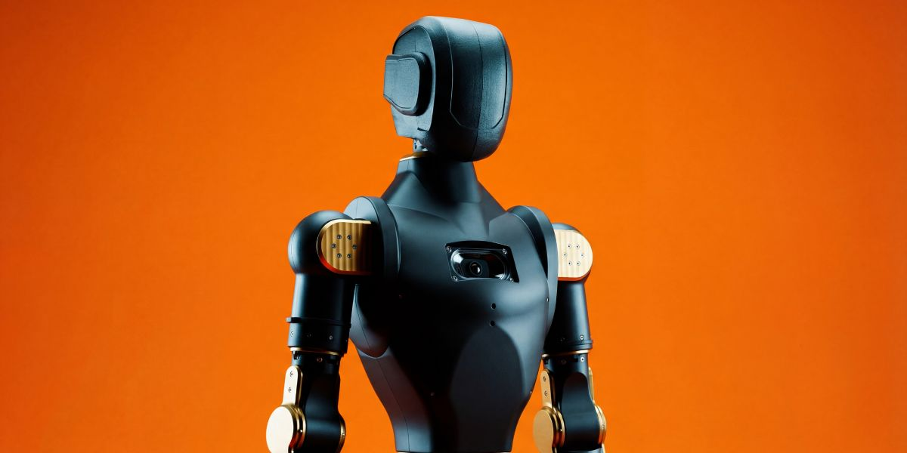

# Asimov v1 - Summary

Asimov v1 is an open-source humanoid robot by Asimov Inc. that can be built, trained, simulated, and customized.

It is a 1.2 m, 35 kg biped with 25 actuated degrees of freedom. The repository includes mechanical CAD, electrical CAD, a simulation model, and onboard software.

## Reference Value

| Point | Why it matters |
| --- | --- |
| Full open-source humanoid | Good example of a complete biped robot platform |
| 25 actuated DOF + 2 passive DOF | Useful for studying full-body joint distribution |
| Mechanical and electrical CAD | Helps compare structure, wiring, PCB, and manufacturing choices |
| MuJoCo simulation model | Useful for simulation and control workflow reference |
| Raspberry Pi 5 + Radxa CM5 compute | Practical example of split media/network and motion-control compute |
| DIY kit and self-source path | Shows both kit-based and independent build approaches |

## Key Specs

| Spec | Value |
| --- | --- |
| Height | 1.2 m |
| Weight | 35 kg |
| Degrees of Freedom | 25 actuated + 2 passive |
| Legs | 6 DOF x 2 + toe x 2 |
| Arms | 5 DOF x 2 |
| Torso | 1 DOF waist yaw, speaker, 6 DOF IMU |
| Head | 2 DOF neck, microphone array, 2MP camera |
| CAN Bus | 5 at 1 Mbps + 1 at 500 kbps |
| Structural Materials | 7075 aluminium, MJF PA12 nylon |

## Why It Is a Good Reference

- Shows what a complete open-source humanoid release can include.
- Useful for comparing DOF, actuator placement, sensors, compute, and control layout.
- Good reference for organizing CAD, electrical, simulation, and software files.
- Strong benchmark for build documentation and open hardware presentation.

## Demo Design

3D design demo: https://static.asimov.inc/asimov/v1/asimov-v1-20260420.html

## Repo Note

Asimov v1 is a strong reference because it combines real hardware design, simulation assets, onboard software, and build documentation in one public project.

Source: https://github.com/asimovinc/asimov-v1

